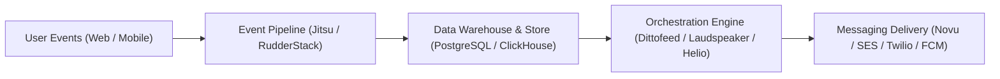

# Awesome Customer Engagement Orchestration 

> A curated directory and ecosystem guide of leading **Customer Engagement Orchestration (CEO)**, **Customer Journey Orchestration (CJO)**, and **Behavioral Messaging** solutions — spanning enterprise SaaS platforms and self-hosted open-source software.

*Focused on Cross-Channel Journeys (Email, SMS, Mobile Push, Web Push, In-App, WhatsApp), Real-Time Segmentation, Event-Triggered Automation, and Behavioral Lifecycle Marketing.*

---

## Table of Contents

- [Sector Overview & Market Dynamics](#sector-overview--market-dynamics)
- [SaaS / Hosted Platforms](#saashosted-platforms)
- [Open-Source GitHub Projects](#open-source-github-projects)
- [Frameworks for Building Custom Stacks](#frameworks-for-building-custom-stacks)
- [How to Contribute](#how-to-contribute)
- [Disclaimer](#disclaimer)

---

## Sector Overview & Market Dynamics

The global **Customer Engagement Solutions & Customer Journey Orchestration (CJO)** market is valued at approximately **$24B–$31B** (with the dedicated CJO segment tracking around **$13B**), expanding at a compound annual growth rate (CAGR) of **12% to 24%** through 2030+. 

The market is **moderately fragmented**: mega-cap enterprise incumbents (Salesforce, Adobe, Microsoft) dominate consolidated marketing clouds, while best-of-breed specialized leaders (Braze, Klaviyo, Iterable) capture high-growth modern tech stacks, coexisting alongside an expanding ecosystem of developer-first and open-source headless journey engines rather than settling into a single winner-take-all monopoly.

---

## SaaS/Hosted Platforms

The table below compiles category-defining commercial platforms for customer journey orchestration and engagement, ranked descending by company scale (market capitalization or latest recorded valuation / revenue).

| Platform | Company Scale (Valuation / Revenue) | Starting Tier Pricing | Free Tier / Trial Limits | Key Capabilities & Highlights |
| :--- | :--- | :--- | :--- | :--- |
| **[Salesforce Marketing Cloud Engagement](https://www.salesforce.com/products/marketing-cloud/engagement/)** | ~$185B–$189B Market Cap ($41.5B FY26 Rev) | $1,500/month (Growth edition, billed annually) | No free tier; no public self-serve trial (Proof-of-Concept via sales demo) | Enterprise cross-channel journey builder, Einstein AI predictive personalization, deep Data Cloud and CRM integration. |
| **[Klaviyo](https://www.klaviyo.com/)** | ~$4.8B Market Cap (~$1.4B ARR) | $20/month (Starts at 500 active profiles) | Free tier forever: up to 250 profiles and 500 email sends/month (150 SMS credits trial) | E-commerce focused lifecycle marketing, automated revenue-attribution flows, predictive churn & LTV metrics. |
| **[Braze](https://www.braze.com/)** | ~$3.2B Market Cap (~$738M ARR) | ~$2,500–$5,000/month (~$30,000–$60,000/year base entry tier) | 14-day free trial (Sandbox access to journey builder and BrazeAI templates; no permanent free plan) | Real-time cross-channel Canvas journey builder, high-throughput mobile push, in-app cards, SMS, and send-time AI. |
| **[Iterable](https://iterable.com/)** | ~$2.0B Valuation (Series E) | ~$1,600–$2,500/month (~$20,000–$30,000/year starting Growth tier) | No free tier; no public self-serve trial (Sales-led customized evaluation sandbox) | Visual workflow designer, mobile SDKs, unified subscriber catalogs, cross-channel experimentation & AI optimization. |
| **[MoEngage](https://www.moengage.com/)** | ~$700M–$900M Valuation ($100M+ ARR) | ~$999/month (Starter package up to 10,000 MAUs) | 14 to 30-day guided evaluation trial (No permanent free tier) | Insights-led customer engagement, Sherpa AI personalization, omnichannel journeys across mobile, web, and WhatsApp. |
| **[CleverTap](https://clevertap.com/)** | ~$775M Valuation (Series D) | $75/month (Core tier starting at 5,000 MAUs) | 30-day free trial on Core tier (Full access for up to 100,000 MAU evaluation; no permanent free tier) | Mobile-first engagement, real-time behavioral user cohorts, TesseractDB event processing, automated journey builder. |
| **[Customer.io](https://customer.io/)** | ~$690M Valuation ($100M+ ARR) | $100/month (Essentials plan, up to 5,000 profiles & 1M emails/mo) | 14-day free trial (Up to 5,000 test messages across email, SMS, push, webhooks; 12-month startup tier for qualified seeds) | Behavioral event-driven messaging pipelines, drag-and-drop workflow builder, native data pipelines and webhooks. |
| **[Airship](https://www.airship.com/)** | ~$500M+ Est. Private Valuation (~$58M ARR) | ~$2,000/month (~$25,000/year base contract tier) | No permanent free tier; time-limited PoC/pilot program via enterprise sales consultation | Pioneer in mobile notifications, rich in-app experiences, mobile wallet management, cross-channel journey sequences. |
| **[Blueshift](https://blueshift.com/)** | ~$150M–$250M Valuation (Acquired by BlueConic) | $1,250/month (Starter plan, billed annually) | 90-day guided pilot trial (CDP & Customer AI engagement suite; no permanent free plan) | SmartHub CDP + omnichannel engagement, patent-pending predictive Customer AI recommendations, real-time trigger flows. |
| **[OneSignal](https://onesignal.com/)** | ~$100M–$200M Est. Valuation (~$25M–$50M ARR) | $19/month (Growth plan base + $0.012/mobile MAU) | Free tier forever: up to 1,000 mobile MAU, 10,000 web push subscribers, and 10,000 email sends/month | High-throughput web & mobile push notifications, multi-step Journeys, in-app modals, and unified messaging APIs. |

---

## Open-Source GitHub Projects

Explore the top self-hostable customer engagement orchestration platforms, notification infrastructures, and event engines, ordered descending by GitHub stargazers count:

- **[n8n](https://github.com/n8n-io/n8n)**   
  *Fair-code workflow automation platform with 400+ native integrations.* Highly extensible visual canvas for orchestrating cross-channel messaging, multi-step webhook workflows, AI agent triggers, and event pipelines with complete data self-sovereignty.

- **[PostHog](https://github.com/PostHog/posthog)**   
  *All-in-one open-source product OS.* Combines real-time event ingestion, user behavior funnels, cohorts, webhooks, and customer journey notification triggers to power developer-centric behavioral messaging.

- **[Novu](https://github.com/novuhq/novu)**   
  *Open-source notification infrastructure and orchestration workflow engine.* Provides a centralized workflow editor to manage multi-channel delivery (email, SMS, push, in-app feed, chat), digests, time delays, and provider fallbacks with code-first workflows.

- **[Chatwoot](https://github.com/chatwoot/chatwoot)**   
  *Open-source customer engagement and conversational relationship management platform.* Delivers real-time omnichannel customer communication across live chat, WhatsApp, SMS, email, and social channels with automated routing rules.

- **[Mautic](https://github.com/mautic/mautic)**   
  *The world's leading open-source marketing automation platform (GPL-3.0).* 100% community-owned and self-hostable with unlimited contacts. Features multi-channel campaigns (email, SMS, web notifications), visual campaign journey builder, behavioral lead scoring, and GDPR compliance.

- **[GrowthBook](https://github.com/growthbook/growthbook)**   
  *Open-source feature flagging and customer experimentation platform.* Enables growth engineers to orchestrate personalized user experiences, rollout flags, and evaluate journey variants with Bayesian and Frequentist statistics.

- **[Plunk](https://github.com/useplunk/plunk)**   
  *Open-source email marketing and event-driven automation platform built on AWS SES.* Provides transactional and automated marketing campaigns triggered by custom application events with a modern API and management UI.

- **[Jitsu](https://github.com/jitsucom/jitsu)**   
  *Open-source customer data platform and event collection pipeline (MIT).* High-performance alternative to Segment for ingesting web/mobile events, transforming payloads in real time, and synchronizing customer traits into messaging destination endpoints.

- **[RudderStack Server](https://github.com/rudderlabs/rudder-server)**   
  *Enterprise-ready open-source customer data pipeline (AGPL-3.0).* Tracks customer events across apps and synchronizes behavioral data into customer engagement platforms, warehouses, and downstream marketing tools.

- **[Dittofeed](https://github.com/dittofeed/dittofeed)**   
  *Developer-first open-source customer engagement and journey orchestration platform (MIT).* Built as an open alternative to Customer.io, Klaviyo, and Braze. Features a visual drag-and-drop journey builder, real-time segmentation, git-integrated templates, and native multi-channel dispatch (Email, SMS, Push, WhatsApp, Slack).

- **[Laudspeaker](https://github.com/laudspeaker/laudspeaker)**   
  *Open-source customer journey automation engine (AGPL-3.0).* Self-hostable alternative to Braze and Iterable featuring a no-code canvas for event-triggered messaging (email, SMS, Firebase push), time delay nodes, user cohorts, and native PostHog analytics sync.

- **[Metarank](https://github.com/metarank/metarank)**   
  *Open-source Learn-to-Rank personalization service (Apache-2.0).* Real-time ranking engine that orchestrates personalized content, dynamic feeds, and recommendations based on explicit and implicit behavioral telemetry.

- **[Apache Unomi](https://github.com/apache/unomi)**   
  *Java-based open-source customer data platform and rules engine (Apache-2.0).* Reference implementation of the OASIS Customer Data Platform specification for real-time customer profiling, event ingestion, and segment evaluation.

- **[Fusion](https://github.com/fusion-hq/fusion)**   
  *Open-source product analytics and user engagement tool.* Combines lightweight behavioral analytics with push notification triggers, live chat, micro-surveys, and real-time user engagement capabilities for modern startups.

- **[OpenClix](https://github.com/OpenClix/openclix)**   
  *Open-source mobile app retention and client-side engagement automation (MIT).* Config-driven engagement rules designed with on-device evaluation logic across TypeScript, Next.js, Dart, Kotlin, and Swift.

- **[Helio](https://github.com/achref-soua/helio)**   
  *AI-native open-source customer growth platform (AGPL-3.0).* Powered by the Temporal workflow engine; delivers sub-100ms event-driven cross-channel journeys, natural-language segmentation, brand-voice AI copywriting, and MCP integration for AI agents.

- **[MessageBirds](https://github.com/Mullassery/MessageBirds)**   
  *Event-driven customer data and engagement platform built in Rust and TypeScript.* Features identity resolution, real-time audiences, PyReverseETL activation, edge ingestion gateways, and durable journey workflows.

---

## Frameworks for Building Custom Stacks

For organizations looking to eliminate vendor lock-in and construct their own self-hosted, sovereign customer engagement infrastructure:

1. **Event Ingestion & Routing**: Stream user interactions through [Jitsu](https://github.com/jitsucom/jitsu) or [RudderStack](https://github.com/rudderlabs/rudder-server).
2. **Behavioral Analytics & Cohorts**: Compute real-time user profiles with [PostHog](https://github.com/PostHog/posthog) or [Apache Unomi](https://github.com/apache/unomi).
3. **Journey Orchestration**: Execute visual multi-step drip campaigns and event-driven triggers via [Dittofeed](https://github.com/dittofeed/dittofeed), [Laudspeaker](https://github.com/laudspeaker/laudspeaker), or [Helio](https://github.com/achref-soua/helio).
4. **Unified Notification Dispatch**: Route outbound payloads through [Novu](https://github.com/novuhq/novu) or [Plunk](https://github.com/useplunk/plunk) to provider channels (SendGrid, Twilio, Firebase, WhatsApp).

---

## How to Contribute

Contributions are welcome! Help keep this curated list accurate and up to date:

1. Fork this repository.
2. Update entries in [README.md](file:///C:/Users/ishan/Documents/Projects/Awesome-Customer-Engagement-Orchestration/README.md).
3. Ensure table criteria are respected:
   - Specific starting tier pricing and specific free tier/trial limits.
   - Proper valuation/market cap ordering.
   - Social star badges linking to the repository stargazers page.
4. Submit a Pull Request with a clear description of changes.

---

## Disclaimer

- This is an independent, community-curated list and does not constitute an endorsement.
- All trademarks, logos, and company brand names are property of their respective owners.
- Customer engagement solutions processing personally identifiable information (PII) must comply with local privacy regulations (GDPR, CCPA, CAN-SPAM). Self-hosted platforms require proper infrastructure hardening and email deliverability setup (SPF, DKIM, DMARC).
